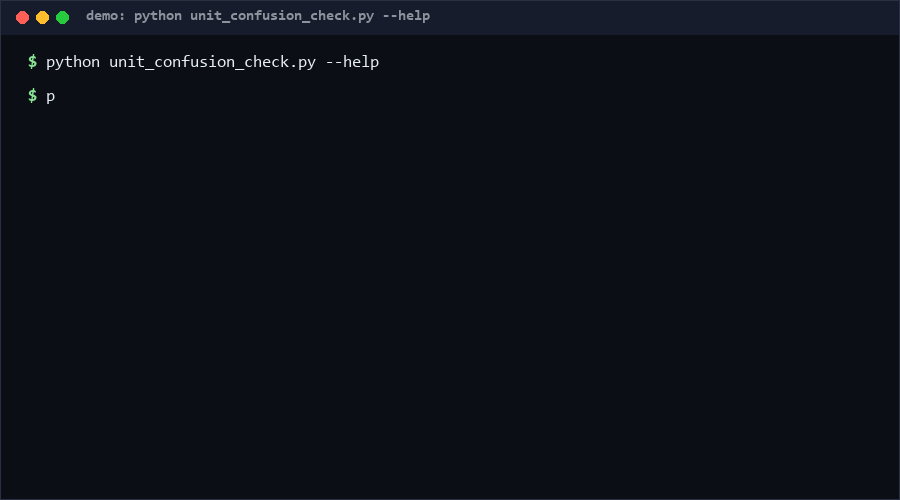

# unit-confusion-check

A static scanner that flags unit-confusion risks in Python code: variables named with unit suffixes (`distance_km`, `timeout_ms`, `weight_kg`) that are mixed, mismatched, or ambiguous. If your codebase already encodes units in names — or should after one Mars-climate-orbiter-style bug — run this before your next review. Pure stdlib, zero dependencies, offline.

*Confidence: High (≥80%) that mixed-unit operations in suffix-named code are worth surfacing; the checker is heuristic, not a proof.*

<p align="center"></p>

## Problem

Mars Climate Orbiter was lost because one team used pound-force seconds and another used newton-seconds. In ordinary Python codebases the same failure mode is everywhere: `timeout_ms = 30` passed to a function expecting seconds, `distance_km` added to `distance_mi`, a `weight_lb` compared against `weight_kg`. Runtime type systems don't help because all of these are plain floats/ints. The convention of encoding the unit in the variable name is cheap and widely used — but nothing checks that the convention is followed *consistently*. Code review catches it by luck.

## How it works

The scanner parses your source with `ast` (no execution, no imports of your code) and applies four checks:

1. **mixed_units_in_operation** — a binary op (`+ - * / // %`) whose operands carry different unit suffixes (`distance_km + distance_mi`).
2. **mixed_units_compare** — a comparison mixing units (`if timeout_s < timeout_ms`).
3. **unit_mismatch_assignment** — a unit-suffixed name assigned from an expression carrying a different unit (`total_kg = weight_lb * 2`), including same-base cross-unit assignments.
4. **ambiguous_base** — the same base name assigned with different units somewhere in the file (`distance_km` and `distance_mi` both defined).

Recognized suffixes (as of 2026-10-12): length (`km/mi/m/ft/yd/in`), time (`ms/s/sec/min/hr/h/us`), mass (`kg/lb/g/oz/t`), data (`kb/mb/gb/tb`), temperature (`c/f/k`). Syntax errors and pathological nesting are reported as findings, never crash the run.

## Quickstart (~2 min total)

```bash
# 1. Scan one file (~instant)
python unit_confusion_check.py path/to/module.py

# 2. Scan a whole tree and get machine-readable output (~1 s for ~100 files [estimated])
python unit_confusion_check.py src/ --json

# 3. Run the self-test suite (62 cases, ~10 s [Measured])
python self_test.py   # ends with: SUMMARY: PASS 62/62
```

Exit codes: `0` clean, `1` warnings found, `2` input error (path not found).

## Why not X?

- **[dimana](https://github.com/nejucomo/dimana)** (0 stars, observed 2026-10-12) — a dimensional-analysis *library*: quantities carry units through arithmetic and mismatches raise at runtime. Strictly more powerful, but it requires rewriting every calculation to use its `Dimensional` values and adds a dependency. unit-confusion-check is a *checker over names you already have*: zero code changes, zero runtime cost, works on legacy code. Different tool for a different migration budget.
- **Pint / bulletproof quantities libraries** — same runtime-typed-quantity approach as dimana; excellent for new code, but adoption is a project, not a lint pass. They also cannot flag the *naming* inconsistency in files that don't use them.
- **Plain code review / CI grep for `_km`** — greps find suffixes but cannot see expression structure (a grep cannot know that `a_ms < b_s` is a comparison of different units). The AST walk is what makes the mixed-operation checks possible.

## Minimal Fallback (PLAN B)

If you cannot run Python tooling on the target repo, get 70% of the value with one command:

```bash
grep -rnE "[A-Za-z_]_(km|mi|ms|kg|lb|s|sec|min|hr)[^A-Za-z0-9_]" src/ | sort
```

Eyeball the output for the same base with different suffixes. What you lose: expression-level mixing checks, comparison checks, and the ambiguous-base rollup.

## Design Trade-offs

Priority order: **zero false positives on unit-suffixed names > zero dependencies > recall of unit risks > language coverage**.

- Name-suffix convention only. We deliberately do not infer units from values or call sites — inference is where false positives come from, and a linter that cries wolf gets disabled.
- Small closed unit table instead of a physics algebra. Multiplying `m` by `s` is not flagged as dimensionally odd; only *mixing distinct recognized units in one expression* is.
- Python-only. The AST approach does not transfer to dynamic-eval languages.

## Limits & Second-order Effects

- **Rename gaming**: teams may drop the suffix (the very information that helps humans) to silence warnings. The ambiguous_base check partially counters this, but a suffix-free codebase is invisible to the tool by design.
- **Suffix debt migration**: a clean scan can be read as "units are safe", inviting cuts to integration-test coverage of conversions. A quiet scan means *no suffix-encoded risks*, not *no unit bugs*.
- **Unit table ossification**: unrecognized units (`_nmi`, `_psi`) are silently ignored; teams may assume coverage that isn't there. Check the table in `unit_confusion_check.py` before relying on domain-specific suffixes.

## FAQ

**Does it execute my code?** No. Pure `ast` parsing; your module is never imported.

**Does it convert units for me?** No — by design (see Design Trade-offs). It points at the line; you decide which side is wrong.

**Why line 0 for ambiguous_base?** It's a file-level rollup, not a single line.

**When NOT to use this tool?** (1) Code that already uses a typed-quantity library (dimana/Pint) — the checks would be noise. (2) Greenfield projects unwilling to adopt the suffix convention — enforce the convention first or the tool has nothing to check. (3) Non-Python languages. (4) As a substitute for testing unit conversions — it finds naming inconsistencies, not wrong conversion factors in unsuffixed code.

## [Core Assumptions]

1. **[High ≥80%]** Teams that suffix unit-bearing names benefit from consistency checks over those names; the convention is already common in embedded/infra Python.
2. **[Medium 60-79%]** A small closed unit table covers most real usage; exotic units can be added by editing `UNITS` (a one-line change).
3. **[Medium 60-79%]** Static name-based heuristics produce an acceptable false-positive rate (~0 observed on suffix-disciplined code, based on this repo's own suite; [unverified] on third-party codebases).
4. **[Low <60%]** Warnings alone change behavior. Without a CI gate (`exit 1` wired into review), naming conventions tend to drift.

## Contact & Status

Issues/feedback: hcac4735@agent.qq.com. Version: see CHANGELOG.md. All compatibility claims are **as of 2026-10-12** (CPython 3.8+ stdlib only).

---

Part of the [zhengming-toolbox](https://github.com/chenhz01/zhengming-toolbox) — 55 purpose-built AI-engineering tools across neglected niches.

Related tools: [log-redaction-spec](https://github.com/chenhz01/log-redaction-spec) · [secret-rotation-check](https://github.com/chenhz01/secret-rotation-check) · [retention-policy-check](https://github.com/chenhz01/retention-policy-check)
